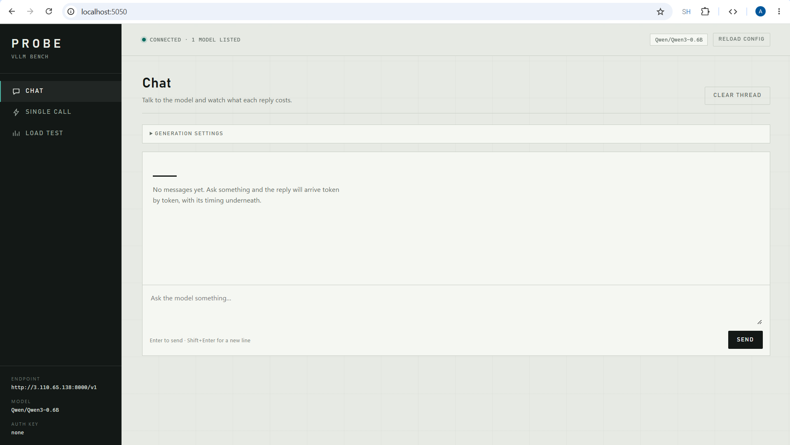
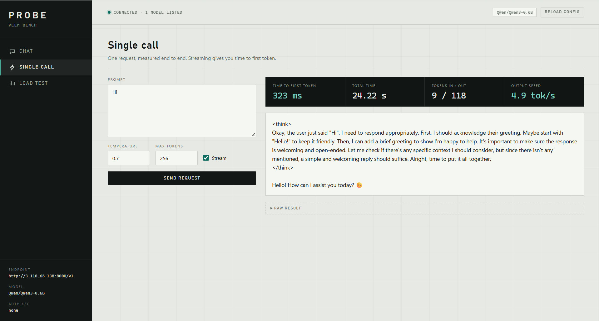
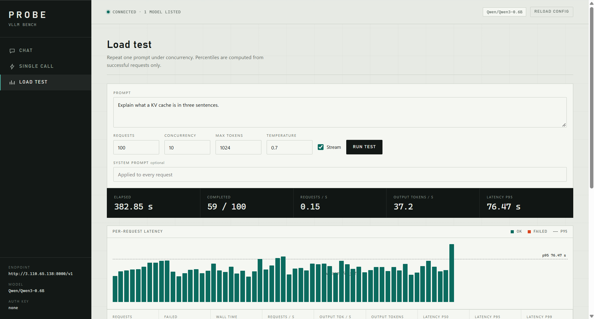

# Probe — vLLM bench UI

A local Flask UI for exercising an OpenAI-compatible vLLM endpoint:

- **Chat** — streamed multi-turn chat, timing every reply.
- **Single call** — one prompt, measured end to end; streaming optional.
- **Load test** — repeat one prompt under concurrency, with a live latency strip,
  live per-request outputs, percentiles, and per-request results.

Everything is measured server-side, around the HTTP call, and shown in the browser
without a build step or a CDN.

## Screenshots

**Chat** — tokens arrive as they are generated, with TTFT, total time, token counts,
and output speed under each reply.



**Single call** — one prompt with a dark readout: time to first token, total time,
tokens in/out, and output speed. The raw result is one click away.



**Load test** — a live latency strip (one tick per request, p95 marked), live output
per request, and percentile summaries. The run below is still in progress.



## Example: reading a real run

The screenshots above are a 100-request load test at concurrency 10 against
`Qwen/Qwen3-0.6B` **running on CPU**, streaming, `max_tokens` 1024. The absolute
numbers are low because there is no GPU behind it; the shape of the curves is the
part that transfers to other hardware.

| Reading at 59/100 completed | Value |
| --- | --- |
| Wall time | 382.85 s |
| Requests / s | 0.15 |
| Output tokens / s | 37.2 |
| Latency p95 | 76.47 s |

What this tells you:

- **Aggregate throughput is low.** 37 output tokens/s across 10 in-flight requests is
  roughly 3.7 tokens/s per request — close to the 4.9 tokens/s the same model managed
  in a single call. Raising concurrency bought almost no extra throughput, so the
  server was saturated, not idle.
- **Latency is queueing, not generation.** p95 at 76 s while a single request finishes
  in ~24 s means requests spent most of their time waiting for a slot. If p95 climbs
  with concurrency but throughput stays flat, add replicas or lower concurrency.
- **TTFT is only part of the story.** The single call above shows TTFT of 323 ms but a
  total of 24.22 s, because the answer took 118 output tokens. TTFT measures when the
  stream opens; total time measures when it finishes.

Qwen3 is a reasoning model, so `max_tokens` covers the ` thinking` block as well as the
final answer. The UI shows raw model output, tags included. Use a larger
`max_tokens` when you want the reasoning to complete.

A sensible first pass on a new endpoint:

1. **Single call** with the prompt you actually care about, streaming on. Note TTFT and tok/s.
2. **Load test** with 10 requests at concurrency 2. Confirm the numbers look like the single call.
3. Raise concurrency to 4, 8, 16 and watch where p95 starts climbing while
   output tok/s stops improving. That knee is your practical concurrency limit.

## Run it

```powershell
python -m pip install -r requirements.txt
copy .env.example .env      # then edit .env
python app.py
```

Open <http://127.0.0.1:5050>.

`.env` is read at startup (values already set in the environment win):

| Variable | Meaning |
| --- | --- |
| `VLLM_BASE_URL` | OpenAI-compatible base, e.g. `http://localhost:8000/v1` |
| `VLLM_MODEL` | Model id exactly as vLLM reports it |
| `VLLM_API_KEY` | Optional bearer token; never sent to the browser |
| `FLASK_HOST` / `FLASK_PORT` | Where this UI listens (default `127.0.0.1:5050`) |
| `REQUEST_TIMEOUT` | Per-request timeout in seconds (default 120) |

Example `.env`:

```dotenv
VLLM_BASE_URL=http://localhost:8000/v1
VLLM_MODEL=Qwen/Qwen3-0.6B
VLLM_API_KEY=
FLASK_HOST=127.0.0.1
FLASK_PORT=5050
REQUEST_TIMEOUT=120
```

## What the numbers mean

- **TTFT** — request sent to the first content token. Only shown when streaming.
- **Latency** — the full HTTP call, request sent to stream closed.
- **tok/s** — completion tokens ÷ generation time (total minus TTFT when streaming).
- **Requests / s** — successful requests ÷ total wall time of the load test.
- **Output tok / s** — successful completion tokens ÷ total wall time.
- Percentiles are linear-interpolated and calculated from **successful** requests only.

Times are measured server-side around the HTTP call with `time.perf_counter()`, so
they include this app's own overhead (usually sub-millisecond on localhost). Token
counts come from vLLM's `usage` block; if a server omits it, the engine estimates
about 4 characters per token and the UI still shows a number.

Load-test requests each open their own connection. That is deliberate for isolated
per-request timings, but if you are chasing peak throughput, results will be slightly
lower than a pooled client's.

## API used by the page

| Route | Purpose |
| --- | --- |
| `GET /api/config` | Endpoint, model, model list, whether a key is set |
| `POST /api/chat/stream` | SSE proxy: `delta`, `done`, `error` events |
| `POST /api/loadtest` | Start a run, returns `{id}` |
| `GET /api/loadtest/<id>/stream` | SSE: `start`, `delta`, `result`, `done`, `error` |
| `POST /api/loadtest/<id>/stop` | Cancel pending requests (in-flight ones finish) |

The load-test stream can be consumed with plain `curl` if you want the numbers
without the page:

```powershell
$body = '{"prompt":"Say hello","count":4,"concurrency":2,"stream":true,"max_tokens":64}'
$run = curl.exe -s -X POST http://127.0.0.1:5050/api/loadtest `
  -H "Content-Type: application/json" --data-binary $body | ConvertFrom-Json
curl.exe -N "http://127.0.0.1:5050/api/loadtest/$($run.id)/stream"
```

## Tests

```powershell
python -m pip install -r requirements-dev.txt
python -m pytest tests -q
```

The tests run the engine and the Flask routes against a real local HTTP server that
speaks the OpenAI streaming and non-streaming formats — no mocked HTTP.
